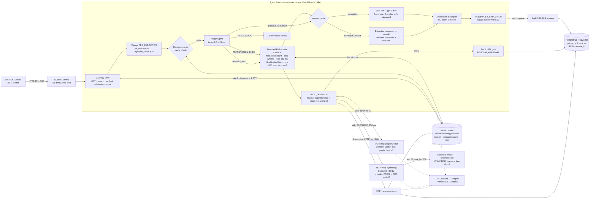

# design.md — The Unreliable Assistant → "Reliable Assistant" v1.1

> **Status:** UNLOCKED — DRAFT-FOR-LOCK (Gate 1). No application code may be written until this file is reviewed and tagged `design-locked`.
> **Source of truth:** *Hackathon Mid-Check Enterprise Blueprint v2* (Gates 0–18, 36 KPIs). Where this file and the blueprint disagree, the resolution is recorded in §0 or Appendix B.
> **Stack (Gate 0):** Python 3.11 · FastAPI/Uvicorn (async) · MCP (JSON-RPC 2.0; stdio local, Streamable HTTP/SSE distributed) · Pluggy lifecycle hooks · Rank-BM25 (Okapi + Porter) + FAISS (HNSW) + `bge-large-en-v1.5` (ONNX) · ONNX Runtime `bge-reranker-v2-m3` FP16 · PostgreSQL+pgvector · Redis Cluster · Obsidian vault + Graphify · OpenTelemetry (OTLP 4317 → Prometheus/Tempo/Grafana) · k6 + JMeter · Streamlit workbench.

**Changes from v1 (the draft this version refines):**
1. Added §0, the decision record. It holds the owner's answers to D-1 … D-8, which v1 did not record.
2. Answer mode is **extractive by default** (D-1). The LLM is used only for Summary and Complex-reasoning answers. §1.4 now shows both paths.
3. The reranker scores the **top 20** of the 40-item RRF pool at `max_len=256` (D-4).
4. The LLM tier is **`gpt-5-mini`** with `reasoning_effort=minimal` (D-6). KPI-25 and KPI-29 are marked at risk until measured.
5. **Arithmetic fix:** the p50 critical-path rows sum to **179 ms**, not 177. Headroom is 61 ms, not 63.
6. k6 p50 threshold aligned to KPI-31 (≤ 240 ms; v1 had 250).
7. Corpus size fixed at **50,000 chunks** (owner-confirmed), which KPI-07 depends on.
8. Added a "Measured to date" table. These are local, non-production numbers.
9. Added ADR-5 to ADR-8 (triage classifier, extractive-first, separate reranker worker, LLM tier).
10. Added Appendix F, the repository state, including known mismatches between the parked code and this design.

**Problems inherited and the section that fixes each**

| Legacy defect | Root cause (assumed from the brief) | Fix |
|---|---|---|
| Hallucinated facts | Single-keyword retrieval, fragmented chunks, ungrounded generation, no faithfulness gate | §1.2.2–1.2.3 3-stage RAG, abstention short-circuit (< 0.42), `ragas_auditor`, extractive-first answers (ADR-6), KPI-10–13, KPI-20–24 |
| Runaway tool loops | Unbounded ReAct; brittle schema validation (`SKU99` vs `SKU-099`) retried forever | §1.2.6 `ToolExecutionHarness`, ADR-4, `circuit_breaker`, KPI-14–17 |
| Cross-user cache leaks | Global / non-tenant cache keys | ADR-3, KPI-28 |
| Context drift | Unbounded history, tool-output noise, no pinning | `GoalAnchorBlock`, observation compression, sliding window + `session_facts` (§1.3 step 7), KPI-18, KPI-26 |
| Latency collapse | Sync I/O, unbatched inference, no backpressure or timeouts | §1.4, §1.6, bulkheads, KPI-31–36 |
| Governance gaps (injection, obfuscated PII, no HITL) | No pre-hooks, no approval gate | §1.1 HITL rule, Appendix A plugins, KPI-01–03, KPI-19 |

**Assumption flagged for review:** the 200–600 ms target is defined as **end-to-end response latency of a grounded answer** (request received → final response/`final` event emitted). The default extractive path meets it with margin. The generative path meets it only for answers of about **24 output tokens or fewer** at ≥ 100 tok/s (§1.4.2). **TTFT** is gated separately (KPI-25 ≤ 180 ms). Longer generative answers are out of scope for the 450/600 ms gates unless the owner re-scopes them and this document is re-opened.

---

## §0 Decision Record (owner answers, 2026-11-13)

| ID | Question | Owner answer | Effect in this file |
|---|---|---|---|
| D-1 | Answer mode for the 450 ms gate | **Extractive-first** | §1.2.8, §1.3 step 9, §1.4 (extractive path), ADR-6 |
| D-2 | Dense index | **FAISS HNSW**, `efSearch=64` | §1.2.2, ADR-1 |
| D-3 | Cache key scope | **Keep per-user keys** (mandate). KPI-27 is at risk. No tenant-shared tier is built | ADR-3, KPI-27 |
| D-4 | Reranker input | **Top 20** of the 40-item RRF pool, `max_len=256` | §1.2.3, §1.4 row 7, §1.4.5, ADR-2 |
| D-5 | Load environment | **Build and verify locally at reduced scale first.** The 50K cluster run is required before release | §1.5 tags, Appendix C |
| D-6 | LLM tier | **GPT-5 family**, default **`gpt-5-mini`**, `reasoning_effort=minimal` | ADR-8, §1.4.2 |
| D-7 | Evaluation datasets | **Authored by the project** (synthetic). Minimums in §1.5 | §1.5, Appendix B |
| D-8 | Golden set (250 Q) | **Owned by the project owner.** Stratified counts: Factoid 63, Complex 62, Multi-Hop 50, Summary 38, Negative 37 | §1.5, Appendix B |

**D-6 cost and latency consequences** (OpenAI pricing page, fetched 2026-11-13):

| Model | Input $/1M | Cached $/1M | Output $/1M | KPI-29 per 1,000 queries (1,320 in + 27 out, all generative) | Blended at 40 % generative share |
|---|---|---|---|---|---|
| `gpt-5` | 1.25 | 0.125 | 10.00 | ≈ $1.92 | ≈ $0.77 — **fails** ≤ $0.45 |
| `gpt-5-mini` | 0.25 | 0.025 | 2.00 | ≈ $0.38 | ≈ $0.15 — passes |

- Reasoning-token billing is not documented on the pricing page. If reasoning tokens bill as output, the costs above are understated. KPI-29 is **unverified** until a metered run.
- Hosted TTFT for GPT-5-family models was not found in any source checked. The 60 ms prefill in §1.4.2 does not include network time. **Expect KPI-25 to fail on the generative path until measured.** The extractive path makes no LLM call and is unaffected. The priority tier lowers latency at roughly 2× the standard price.

---

## 1.1 System Charter & Hard Boundaries

### Scope (in)
1. Grounded question answering over tenant-owned knowledge (documents, SOPs, product catalogs as atomic Obsidian notes, code repositories) with mandatory citations.
2. Tiered tool use via MCP: `TIER_1_READ` (retrieval, graph expansion, state read), `TIER_2_COMPUTE` (validation, calculation), `TIER_3_MUTATE` (form submission, workflow transitions). Tier 3 is **always** behind an asynchronous HITL gate.
3. Multi-tenant, multi-user session continuity with auditable, hash-chained persistence.
4. Deterministic, hot-swappable safety and observability through lifecycle plugins, decoupled from LLM reasoning.
5. Extractive answers by default; generative answers only for Summary and Complex-reasoning queries (D-1).

### Non-goals (out)

| # | Non-goal | Enforcement |
|---|---|---|
| NG-1 | **No autonomous clinical, financial, or legal execution without HITL.** The system may *inform*; any state-mutating action (Tier 3) writes `PENDING_APPROVAL` and pauses until an authorized reviewer approves. | RBAC tier check in `ToolExecutionHarness`; Execution Subagent freezes on Tier 3; default for unknown tools = deny. |
| NG-2 | No cross-tenant data sharing or cross-tenant model-context mixing. | ADR-3, KPI-28. |
| NG-3 | No training on tenant data. | Provider config `zero_retention=true`. |
| NG-4 | No unbounded agent autonomy (no self-spawned agents, no self-modifying tool lists, no recursive self-calls without state mutation). | ADR-4, hard caps. |
| NG-5 | No answers without evidence: if the top cross-encoder score is < 0.42 the system abstains deterministically (no LLM call). | §1.2.3 abstention short-circuit; KPI-23. |
| NG-6 | No raw PII reaching the LLM provider, logs, caches, or persistence (including obfuscated forms such as `name[at]domain`). | `pii_redactor`, fail-closed; KPI-02. |
| NG-7 | No unsigned MCP servers. | Signed MCP server manifests verified at startup (Gate 13). |

### HITL rule
The triage classifier tags `risk_tier`. Domains `clinical | financial | legal` get an informational disclaimer prefix. Any request that implies an action (e.g. "approve this payment", "adjust dose") is a Tier 3 call. The Execution Subagent writes a `PENDING_APPROVAL` record to Postgres, returns `hitl_ticket_id`, and the action is **never executed** until an authorized reviewer approves via UI/API (Streamlit Tab 1 queue). KPI-19 requires 100 % enforcement.

### Personas

| Persona | Needs | Constraint |
|---|---|---|
| **End User (Analyst / clinician-support / support agent)** | Fast, cited answers | Sees only own tenant's/ACL's data |
| **Tenant Admin** | Manage corpora, ACLs, retention | Cannot read other tenants |
| **HITL Reviewer** | Approve/reject Tier 3 requests with full context | Approves only within own tenant and domain scope |
| **Compliance Auditor** | Replay any answer: query, evidence, tool calls, scores | Read-only access to audit log |
| **Platform SRE** | Operate at 50k VUs, meet SLOs | No access to tenant content, only redacted telemetry |
| **Plugin Developer** | Add hooks without touching the LLM loop | Plugins sandboxed by stage contract |

---

## 1.2 MCP Tool & Data Contracts

All MCP traffic is JSON-RPC 2.0 (stdio for local workers, Streamable HTTP/SSE for distributed services). The host is the FastAPI app using `mcp.ClientSession`. Every request carries `_meta: {tenant_id, user_id_hash, request_id, trace_id, deadline_ms, idempotency_key}`. Servers **must** reject calls lacking `_meta.tenant_id` (`-32011`) and must honor `deadline_ms` (cooperative cancel). MCP client serialization overhead budget: p95 ≤ 4 ms (KPI-30). Default per-call MCP timeout: 150 ms (`mcp_config.json`).

### 1.2.1 Shared constrained types (Pydantic v2)

```python
from typing import Annotated, Literal
from uuid import UUID
from pydantic import BaseModel, ConfigDict, Field, StringConstraints as SC

TenantId   = Annotated[str, SC(pattern=r"^[a-z0-9][a-z0-9-]{2,31}$")]
UserHash   = Annotated[str, SC(pattern=r"^[a-f0-9]{32}$")]            # truncated HMAC-SHA256 of user id
SessionId  = Annotated[str, SC(pattern=r"^[0-9A-HJKMNP-TV-Z]{26}$")]   # ULID
RequestId  = Annotated[str, SC(pattern=r"^[0-9A-HJKMNP-TV-Z]{26}$")]
ChunkId    = Annotated[str, SC(pattern=r"^[a-z0-9-]{3,32}:[A-Za-z0-9_.-]{1,64}:\d{1,6}$")]  # tenant:doc:ordinal
ChunkHash  = Annotated[str, SC(pattern=r"^[a-f0-9]{64}$")]            # dedup key in RRF
NoteSlug   = Annotated[str, SC(pattern=r"^[\w\-./ ]{1,200}$")]         # vault note path; validator rejects '..'
QueryText  = Annotated[str, SC(min_length=1, max_length=4000, strip_whitespace=True)]
SkuId      = Annotated[str, SC(pattern=r"^SKU-\d{3,6}$")]              # canonical form; auto-repair target
LotId      = Annotated[str, SC(pattern=r"^LOT-\d{5}$")]                # canonical form; auto-repair target

class Strict(BaseModel):
    model_config = ConfigDict(extra="forbid", frozen=True, str_strip_whitespace=True)

class Meta(Strict):
    tenant_id: TenantId
    user_id_hash: UserHash
    request_id: RequestId
    trace_id: Annotated[str, SC(pattern=r"^[a-f0-9]{32}$")]            # W3C traceparent trace-id
    deadline_ms: Annotated[int, Field(ge=10, le=2000)]
    idempotency_key: UUID                                              # UUIDv4, enforced by harness

class Citation(Strict):
    chunk_id: ChunkId
    uri: Annotated[str, SC(pattern=r"^rag://chunks/[A-Za-z0-9:_.-]+$")]
    quote_span: tuple[int, int]
```

### 1.2.2 Tool: `hybrid_retrieve` (server `mcp-hybrid-rag`), Stages 1–2 and RRF

Stage 1: BM25Okapi + PorterStemmer + inverted index (`k1=1.25`, `b=0.75`, `top_k=50`, pre-tokenized, < 12 ms). Stage 2: bi-encoder `bge-large-en-v1.5` (ONNX) + **FAISS HNSW** (`efSearch=64`, `top_k=50`, < 25 ms), chunks of 512 tokens with 64-token overlap (D-2). Fusion by Reciprocal Rank Fusion (`k=60`), dedup by `chunk_hash`, pool = 40 (< 3 ms).

```python
class HybridRetrieveIn(Strict):
    meta: Meta
    query: QueryText
    sparse_top_k: Annotated[int, Field(ge=1, le=100)] = 50
    dense_top_k: Annotated[int, Field(ge=1, le=100)] = 50
    bm25_k1: Annotated[float, Field(ge=0.5, le=2.5)] = 1.25   # Streamlit Tab 2 slider
    bm25_b: Annotated[float, Field(ge=0, le=1)] = 0.75        # Streamlit Tab 2 slider
    rrf_k: Annotated[int, Field(ge=1, le=200)] = 60           # ADR-1
    pool: Annotated[int, Field(ge=1, le=100)] = 40
    filters: dict[Annotated[str, SC(pattern=r"^[a-z_]{1,32}$")], str | int | bool] = {}
    # filters can only NARROW the ACL, never widen it.

class RetrievedChunk(Strict):
    chunk_id: ChunkId
    chunk_hash: ChunkHash
    text: Annotated[str, Field(max_length=3000)]
    bm25_score: float | None
    cosine_score: float | None
    rrf_score: float
    source_uri: str
    acl_fingerprint: Annotated[str, SC(pattern=r"^[a-f0-9]{16}$")]

class HybridRetrieveOut(Strict):
    chunks: Annotated[list[RetrievedChunk], Field(max_length=40)]   # RRF pool
    bm25_ms: float; dense_ms: float; rrf_ms: float
    degraded: Literal["none", "dense_only", "sparse_only"] = "none"
```

MCP descriptor:
```json
{"name":"hybrid_retrieve","description":"Tenant-scoped BM25 + bi-encoder retrieval fused with RRF. Read-only.",
"inputSchema":{"$ref":"#/$defs/HybridRetrieveIn"},"outputSchema":{"$ref":"#/$defs/HybridRetrieveOut"},
"annotations":{"readOnlyHint":true,"idempotentHint":true,"openWorldHint":false,"risk":"low","tier":"TIER_1_READ"}}
```
Resource template: `rag://chunks/{id}` → `ReadResourceResult` with `mimeType: text/markdown`. ACL is checked on every read.

### 1.2.3 Tool: `rerank` (Stage 3 cross-encoder, ONNX, MCP-wrapped for uniform auditing)

`bge-reranker-v2-m3`, ONNX FP16, batch 32, **`max_len=256`**, `rerank_k=4`, sigmoid threshold > 0.42, < 45 ms. **Input is the top 20 of the 40-item RRF pool (D-4).** The orchestrator selects the top 20 before calling this tool.

```python
class RerankIn(Strict):
    meta: Meta
    query: QueryText
    candidates: Annotated[list[RetrievedChunk], Field(min_length=1, max_length=20)]   # D-4: top 20 of pool 40
    rerank_k: Annotated[int, Field(ge=1, le=8)] = 4
    threshold: Annotated[float, Field(ge=0, le=1)] = 0.42      # Streamlit Tab 2 slider; incident runbook may raise to 0.55
    max_len: Literal[256] = 256                                 # D-4

class RerankOut(Strict):
    ranked: list[tuple[ChunkId, float]]          # sorted desc, only scores > threshold, len <= rerank_k
    top_score: float
    abstain: bool                                # True when top_score < threshold -> deterministic abstention
    precision: Literal["fp16"]
    degraded: bool = False                       # True = fell back to rrf_score order (FMEA #2)
```

**Deterministic abstention short-circuit (Gate 9):** if `top_score < threshold`, the orchestrator bypasses LLM generation and emits a fixed abstention response in < 90 ms (zero hallucination risk, about 80 % token savings on those queries).

### 1.2.4 Tool: `graphify_expand` (server `mcp-graphify-vault`)

`graphify build ./src ./knowledge_vault --output graph.json` produces the unified dependency graph (Python modules, Pydantic schemas, Obsidian policy nodes). At runtime the server resolves the query anchor node and traverses **at most depth 2** over `[[wikilinks]]` and dependency edges, injecting only the minimal connected subgraph (about 320 tokens vs about 1,400 for a raw chunk dump).

```python
class GraphifyExpandIn(Strict):
    meta: Meta
    seeds: Annotated[list[NoteSlug | ChunkId], Field(min_length=1, max_length=8)]
    hops: Annotated[int, Field(ge=1, le=2)] = 2
    token_budget: Annotated[int, Field(ge=200, le=2000)] = 320
    edge_types: list[Literal["wikilink", "import", "call", "backlink"]] = ["wikilink", "import"]

class GraphifyExpandOut(Strict):
    nodes: list[dict]            # {id, summary(<=240 tok), edge_from, hop, risk_tier, version}
    tokens_used: int
    tokens_saved_vs_raw: int
```
Vault notes are atomic Markdown with strict YAML frontmatter (`id`, `domain`, `risk_tier`, `version`) and explicit `[[wikilinks]]` to related rules.

### 1.2.5 Tools: `state_get` / `state_put` / `audit_append` / `workflow_submit` (server `mcp-state-store`)

```python
class SessionFact(Strict):
    fact: Annotated[str, Field(max_length=300)]
    source_chunk_id: ChunkId
    verified: Literal[True] = True

class SessionState(Strict):                    # hot window (Redis/RAM) + durable facts (Postgres `session_facts`)
    session_id: SessionId
    turn_index: Annotated[int, Field(ge=0, le=500)]
    goal_anchor: "GoalAnchorBlock"
    last_turns: Annotated[list[dict], Field(max_length=3)]         # sliding window = last 3 ReAct turns
    schema_version: Literal[1] = 1

class GoalAnchorBlock(Strict):                 # immutable; prepended at index 0 of every ReAct prompt
    original_intent: QueryText
    normalized_entities: dict[str, str]        # e.g. {"sku": "SKU-099"}
    policy_constraints: Annotated[list[str], Field(max_length=10)]

class StatePutIn(Strict):
    meta: Meta; state: SessionState
    expected_version: int          # optimistic concurrency; mismatch -> -32021

class WorkflowSubmitIn(Strict):                # TIER_3_MUTATE; never executes directly
    meta: Meta
    workflow: Annotated[str, SC(pattern=r"^[a-z_]{3,48}$")]
    payload: dict

class WorkflowSubmitOut(Strict):
    status: Literal["PENDING_APPROVAL"]
    hitl_ticket_id: str

class AuditRecord(Strict):
    meta: Meta
    query_redacted: str
    evidence_ids: list[ChunkId]
    tool_calls: list[dict]
    answer_redacted: str
    answer_mode: Literal["extractive", "generative", "abstained"]
    faithfulness: float | None
    plugin_decisions: list[dict]
    prev_hash: Annotated[str, SC(pattern=r"^[a-f0-9]{64}$")]          # SHA-256(prev_hash + event_payload), tamper-evident
```
Postgres `session_facts` is keyed by `session_id` and carries `tenant_id` on every row. Every query includes `tenant_id`.

### 1.2.6 Triage contract and `ToolExecutionHarness`

**Triage Agent:** front-door distilled classifier, `temperature=0.0`, p95 ≤ 25 ms (ADR-5). It is not an LLM call.
```python
class TriageOut(Strict):
    intent: str; domain: Literal["general", "clinical", "financial", "legal", "inventory", "other"]
    risk_tier: Literal["TIER_1_READ", "TIER_2_COMPUTE", "TIER_3_MUTATE"]
    complexity: Literal["low", "medium", "high"]
    route: Literal["DIRECT_ANSWER", "HYBRID_RAG", "TRANSACTION_EXEC", "REJECT_OOS"]
    confidence: float = Field(ge=0.0, le=1.0)
```
Rule: `confidence < 0.80` forces `route = HYBRID_RAG` (read-only). Triage never defaults to `TRANSACTION_EXEC`.

**Every MCP tool call passes `ToolExecutionHarness`**, in order:
1. Pydantic v2 strict validation.
2. Deterministic regex auto-repair (e.g. `SKU99` → `SKU-099`, `lot 44` → `LOT-00044`). Repaired args are re-validated, and the original is preserved in the audit record. A repair applies only when exactly one pattern matches and the number is in range; otherwise the call fails with `-32602`. Input is NFKC-normalized before any pattern runs.
3. RBAC tier check (`TIER_1_READ`, `TIER_2_COMPUTE`, `TIER_3_MUTATE`) against the subagent's grant.
4. `UUIDv4` idempotency-key enforcement. A duplicate key returns the stored result and never re-executes.

KPI-14 (first-pass validity ≥ 96 %) and KPI-15 (auto-repair success ≥ 90 %) are measured here.

**Normalization and cache key:**
```
norm_query = casefold(NFKC(collapse_ws(query))) |> canonical_entities
cache_key  = t:{tenant}:sc:{sha256(f"{tenant_id}:{user_id}:{norm_query}")}   # ADR-3
ttl        = 300 + uniform(-45, +45) seconds
```

### 1.2.7 Subagent topology (isolation rules)

| Subagent | Core responsibility | Bound MCP servers | Isolation & guardrail rule |
|---|---|---|---|
| **Retrieval** | Query rewriting, 3-stage hybrid RAG, citation grounding | `mcp-hybrid-rag`, `mcp-graphify-vault` | Read-only; cannot invoke state-mutating tools |
| **Execution** | Schema validation, form submission, workflow transitions | `mcp-state-store` | No RAG/external web access; Tier 3 triggers HITL freeze |
| **Verification** | Claim-to-chunk NLI check, RAGAS triad audit, OTel logging | `mcp-state-store` (audit log only) | Independent model context; vetoes ungrounded drafts |

Gate 2 of the blueprint calls the third branch "Audit Subagent". It is the same component (Appendix B, item 3).

### 1.2.8 Public API (FastAPI)

`POST /api/v1/agent/query` (JSON; the endpoint exercised by k6 and JMeter) and `POST /api/v1/agent/stream` (SSE; used for TTFT, KPI-25). Auth: OIDC JWT → `tenant_id`, `user_id`. Body: `{session_id?, message: QueryText}`. A `tenant_id` in the body or an `X-Tenant-ID` header is accepted **only as a consistency assertion**. It must equal the JWT claim, otherwise `-32011`. It is never the source of truth.

Response (JSON): `{answer, answer_mode: "extractive" | "generative" | "abstained", citations[], route, tenant_id, faithfulness, abstained, trace_id, hitl_ticket_id?}`. The `tenant_id` echo and the inline `faithfulness` score (Verification Subagent NLI) are asserted by the load tests (Appendix C).

SSE events: `token`, `citation`, `tool_status`, `final {answer_mode, faithfulness, hitl_ticket_id?}`, `error {code, message, retryable}`.

### 1.2.9 Error codes

| Code | Name | Retryable | Meaning |
|---|---|---|---|
| -32700 | ParseError | no | JSON-RPC std |
| -32600 | InvalidRequest | no | JSON-RPC std |
| -32601 | MethodNotFound | no | Unknown or denied tool |
| -32602 | InvalidParams | no | Pydantic validation failed (after auto-repair attempt) |
| -32603 | InternalError | yes (1×) | Unhandled server fault |
| -32001 | DeadlineExceeded | yes (fallback) | `deadline_ms` or per-step timeout elapsed |
| -32002 | UpstreamUnavailable | yes | Dependency down |
| -32003 | RateLimited | yes (after `retry_after_ms`) | Tenant or user quota |
| -32011 | TenantMissing | no | `_meta.tenant_id` absent or invalid, or mismatches JWT |
| -32012 | AclDenied | no | Chunk or note outside ACL, or RBAC tier denied |
| -32013 | PiiBlocked | no | Redactor failed closed |
| -32014 | InjectionBlocked | no | Shield verdict ≥ threshold |
| -32015 | HitlRequired | no | Tier 3 action awaiting human (`PENDING_APPROVAL`) |
| -32021 | VersionConflict | yes | State CAS mismatch |
| -32031 | LoopBudgetExceeded | no | `max_iterations=5` or 450 ms loop budget hit |
| -32032 | CircuitOpen | yes (later) | Breaker open (`HALTED_BREAKER`) for this `(tool, args-hash)` |
| -32041 | UngroundedAnswer | no | Cross-encoder top score < 0.42, faithfulness < 0.92, or no evidence → abstain |
| -32042 | ContextOverflow | no | Token budget breach after compression |
| -32051 | ReplayedIdempotencyKey | no | Duplicate UUIDv4 key; stored result returned |

---

## 1.3 Distributed Topology & Data Flow



**Bulkheads:** isolated pools per dependency: `rag_pool=64`, `db_pool=128`, `llm_pool=256`, plus a separate health-check pool. A slow reranker cannot starve health checks or triage routing.

### Request data flow (happy path, cache miss, `HYBRID_RAG`, extractive answer)
1. NGINX/Envoy → Gateway: verify JWT, derive `tenant_id` and `user_hash`, token-bucket check in Redis, admission control (shed at queue wait > 25 ms → 429 with `Retry-After`).
2. **PRE_EXECUTION** (`hook.pre`): `pii_redactor` (p10) → `injection_shield` (p20). Both fail-closed. p95 ≤ 15 ms (KPI-01).
3. **Semantic cache lookup** (`cache.lookup`) per ADR-3. Hit → skip to step 11.
4. **Triage** (`triage.classify`, ≤ 25 ms) → `(intent, domain, risk_tier, complexity)` → route. `REJECT_OOS` skips retrieval. `DIRECT_ANSWER` skips retrieval, and the orchestrator discards any speculative retrieval already started.
5. Build `GoalAnchorBlock` (original intent, normalized entity IDs after harness auto-repair, active policy constraints). Load the last-3-turn window from Redis (miss → Postgres replica `session_facts`).
6. Retrieval Subagent → `hybrid_retrieve` (BM25 ‖ dense → RRF pool 40). The orchestrator takes the top 20 → `rerank` (top 4, threshold 0.42, `max_len=256`). If `top_score < 0.42`: **abstain deterministically** (< 90 ms), skip to step 11. Concurrently, `graphify_expand` (depth ≤ 2).
7. Context assembler: `GoalAnchorBlock` at index 0, reranked evidence, graph subgraph (about 320 tokens). Every tool observation is compressed to ≤ 180 tokens by the extractive compressor. Verified facts are persisted to `session_facts`.
8. Bounded ReAct loop (`INIT → TRIAGE → REASONING → TOOL_CALL → OBSERVATION → VERIFY → DONE/HALTED`): ≤ 5 iterations, 120 ms per step, 450 ms total. Every tool call passes `ToolExecutionHarness` and then `circuit_breaker`. A Tier 3 call goes to the HITL gate → `PENDING_APPROVAL`, and the loop pauses.
9. **Answer composition** (D-1): the extractive composer is the default. It quotes verified sentences from the top 4 chunks, each with a citation. The LLM composes only for Summary and Complex queries (`llm.generate`, generative path).
10. Verification Subagent: claim-to-chunk NLI check (inline, cheap) → `faithfulness`. An ungrounded draft is vetoed → abstain (`-32041`).
11. Egress: response or stream `final` is emitted. Every sentence must map to a retrieved `chunk_id`, or it is suppressed.
12. **POST_EXECUTION** (`hook.post.ragas`, async, off the critical path): full RAGAS audit. `< 0.92` → answer flagged and record marked `needs_review`. An audit row is appended (hash-chained). The semantic-cache write happens only if the score is ≥ 0.92.
13. `otel_exporter` spans are emitted for every stage.

**Data residency and isolation:** Postgres RLS (`USING tenant_id = current_setting('app.tenant_id')`). `tenant_id` appears in every SQL query and Redis key. FAISS shards are per tenant tier. No raw PII is persisted. MCP server manifests are signed.

---

## 1.4 End-to-End Latency Budget (200–600 ms)

**Metric:** client-observed end-to-end response latency at 50,000 concurrent VUs, cache-miss path. Targets: **p50 ≤ 240 ms, p95 ≤ 450 ms, p99 ≤ 590 ms (< 600 ms)**, which are KPI-31/32/33. Cache-hit p95 target ≤ 120 ms. Deterministic abstention ≤ 90 ms. TTFT p95 ≤ 180 ms (KPI-25).

### 1.4.1 Critical path, generative path (D-1 option b, or Summary/Complex)

| # | Stage / OTel span | p50 ms | **p95 budget ms** | **p99 budget ms** | Mechanism |
|---|---|---:|---:|---:|---|
| 1 | LB + TLS (resumed) + HTTP/2 + gateway (JWT, rate-limit) | 5 | 10 | 15 | Keep-alive, TLS 1.3 resumption, local JWKS cache, one pipelined Redis RTT |
| 2 | `hook.pre`: PII + injection | 8 | 15 | 22 | Regex/Aho-Corasick first pass + small ONNX classifier (CPU); KPI-01 |
| 3 | `cache.lookup` | 2 | 5 | 8 | Same-AZ Redis, single key probe |
| 4 | `triage.classify` | 12 | 25 | 32 | Distilled classifier, deterministic argmax; KPI-05 |
| 5 | Retrieval S1 ‖ S2 (`rag.bm25` ‖ `rag.dense`) | 15 | 25 | 35 | Parallel; BM25 ≤ 12 ms (KPI-07); embed + HNSW ≤ 25 ms (KPI-08); 150 ms hard MCP timeout |
| 6 | `rag.rrf` | 1 | 3 | 5 | Rank arithmetic only, pool 40 |
| 7 | `rag.rerank` (cross-encoder, **top 20 at 256 tokens**) | 25 | 45 | 60 | ONNX FP16, micro-batch 32 / 8 ms wait; KPI-09 (to re-measure on GPU, D-4) |
| 8 | Graphify depth ≤ 2 (parallel with 7; excluded from sum) | 8 | 20 | 30 | Pre-built adjacency, in-memory LRU |
| 9 | Context assembly + observation compression | 5 | 10 | 15 | Extractive compressor, no LLM |
| 10 | `llm.generate` (generative path only, ≤ 24 output tokens, streamed) | 100 | 240 | 330 | gpt-5-mini, `reasoning_effort=minimal`; accelerator-hosted or provider-hosted TTFT not yet measured (ADR-8) |
| 11 | Verification NLI + citation check + egress flush | 6 | 15 | 25 | Small NLI model, string-match citation check |
| | **Sum, generative path** | **179** | **393** | **547** | |
| | **Headroom to target (jitter, GC, queueing)** | **61** | **57** | **43** | |
| | **Target (KPI-31/32/33)** | **240** | **450** | **590** | |

### 1.4.2 Extractive path (default, D-1)

Row 10 is replaced by the extractive composer. Rows 1–9 and 11 are unchanged.

| # | Stage | p50 ms | p95 ms | p99 ms |
|---|---|---:|---:|---:|
| 10′ | `compose.extractive` (sentence selection, citation mapping; no LLM) | 3 | 5 | 8 |
| | **Sum, extractive path** | **82** | **158** | **225** |
| | **Headroom to target** | **158** | **292** | **365** |

The extractive path has about 290 ms of p95 headroom. The generative path has 57 ms.

**Generative-path ceiling:** TTFT is about 174 ms. At ≥ 100 tok/s, output must stay within about 27 tokens to fit the 450 ms p95 target with queueing margin. The 240 ms budget for row 10 covers about 24 tokens. Longer answers must use the extractive path or accept a separate SLO (ADR-6).

### 1.4.3 Structural p99 bound (hard timeouts)

| Stage | Hard timeout ms | Fallback |
|---|---:|---|
| Gateway | 10 | Reject 503 |
| `hook.pre` | 25 | Fail-closed → `-32013` / `-32014` |
| `cache.lookup` | 15 | Treat as miss (fail-open for cache only) |
| `hybrid_retrieve` | 150 | FMEA rows 3, 4, 5 |
| `triage` | 25 | Default route `HYBRID_RAG` |
| LLM first token | 250 | Extractive fallback (no generation) |
| Compose + egress | 25 | — |

Worst case: 10 + 25 + 15 + 150 + 250 + 25 = 475 ms, plus a 25 ms fallback allowance = **500 ms**, under the 600 ms ceiling. This bound holds regardless of load. Queueing is covered by the utilization target in §1.4.4.

### 1.4.4 Load arithmetic (why KPI-35 is a floor)

- With `sleep(1)` think time and 50,000 VUs at about 0.4 s mean latency, offered load is about 50,000 / 1.4 ≈ **35,700 RPS**.
- Little's law: 8,500 RPS at 1.4 s per iteration implies only about 11,900 concurrent VUs. The 50K VU test offers about **4× the KPI-35 floor**. That is intended: the test must prove the floor with margin.
- Utilization target: ≤ 60 % per stage at the 50K offered load. Above that, queueing breaks the p95 gate regardless of the service-time budget.
- **Open:** the load model in the blueprint (`sleep(1)` per VU) and the arrival model must be fixed before Appendix C is run (Appendix B, item 10).

### 1.4.5 Reranker capacity check (D-4)

- Before D-4: pool 40 × `max_len` 512 ≈ 20,480 tokens per cache-miss request ≈ **113 M tok/s** at the KPI-35 floor (8,500 RPS × 65 % miss rate). That is hundreds of accelerators.
- After D-4: top 20 × `max_len` 256 = 5,120 tokens per request. At 5,525 misses/s that is ≈ **28 M tok/s**. Still GPU-scale, but about 4× smaller.
- KPI-09 (45 ms) is unchanged. It must be re-measured on GPU with the top-20 input. No reranker latency has been measured.

### 1.4.6 Measured to date (local, non-production)

| KPI | Measured | Gate | Host and corpus | Status |
|---|---|---|---|---|
| KPI-01 pre-hook p95 | 0.065 ms (n=2000) | ≤ 15 ms | 4 vCPU; 7 query templates | PASS locally. Not representative of production inputs |
| KPI-07 BM25 p95 | 9.65 ms (n=500) | ≤ 12 ms | 4 vCPU; synthetic Zipf, 50,000 chunks × 512 tokens | PASS locally with a thin margin. Synthetic corpus |
| KPI-07 BM25 correctness | Max score difference vs `rank_bm25` 3.9e-13 | matches reference | k1=1.25, b=0.75, 50 queries | Correctness check, not a KPI |
| Unit tests (harness, breaker, loop, PII, injection, cache, audit, BM25) | 55 passed | — | Parked code (Appendix F) | Passing |

No other KPI has been measured.

---

## 1.5 KPI & SLA Gate Matrix (36 gates, all must pass to release)

**Tags:** `CI` = runs on the CPU sandbox with a labeled dataset. `GPU` = needs an accelerator for the latency to mean anything. `EVAL` = needs the golden dataset and an LLM judge. `LOAD` = needs the 50K cluster (D-5). `SOAK` = 1-hour run, single node acceptable.

**Dataset minimums (D-7):** injection ≥ 1,000 prompts; negatives ≥ 200; PII spans ≥ 1,000; triage labels ≥ 500; benign controls ≥ 500. The 100-prompt red-team suite (Gate 14) is kept for coverage, not for KPI-03.

| # | Stage | KPI | Threshold (hard) | Measurement tool | Tag | Status |
|---|---|---|---|---|---|---|
| 01 | 1. Ingress & Triage | Pre-hook guardrail latency (p95) | ≤ 15 ms | OTel `hook.pre` | CI | **measured locally, PASS** (§1.4.6) |
| 02 | 1. Ingress & Triage | PII redaction recall (email/phone/SSN/obfuscated) | ≥ 99.8 % | Presidio / regex audit | CI | NOT STARTED |
| 03 | 1. Ingress & Triage | Prompt-injection block rate (direct + indirect) | ≥ 99.5 % | Red-team benchmark | CI | NOT STARTED |
| 04 | 1. Ingress & Triage | Triage routing accuracy | ≥ 97.0 % | Labeled intent set | CI | NOT STARTED |
| 05 | 1. Ingress & Triage | Triage classification latency (p95) | ≤ 25 ms | OTel `triage` | CI | NOT STARTED |
| 06 | 1. Ingress & Triage | False-positive refusal rate on benign queries | ≤ 1.0 % | Benign control set | CI | NOT STARTED |
| 07 | 2. Hybrid Retrieval | Stage 1 BM25 latency (p95) | ≤ 12 ms | OTel `rag.bm25` | CI | **measured locally, PASS** on synthetic 50K corpus |
| 08 | 2. Hybrid Retrieval | Stage 2 bi-encoder + FAISS latency (p95) | ≤ 25 ms | OTel `rag.dense` | GPU | NOT STARTED |
| 09 | 2. Hybrid Retrieval | Stage 3 cross-encoder rerank latency (p95) | ≤ 45 ms | OTel `rag.rerank` | GPU | NOT STARTED |
| 10 | 2. Hybrid Retrieval | Hybrid context recall@50 | ≥ 0.92 | RAGAS / IR eval | EVAL | NOT STARTED |
| 11 | 2. Hybrid Retrieval | Post-rerank context precision@4 | ≥ 0.88 | RAGAS evaluator | EVAL | NOT STARTED |
| 12 | 2. Hybrid Retrieval | Mean reciprocal rank (MRR@4) | ≥ 0.85 | IR benchmark script | EVAL | NOT STARTED |
| 13 | 2. Hybrid Retrieval | nDCG@4 | ≥ 0.86 | IR benchmark script | EVAL | NOT STARTED |
| 14 | 3. Agent & Loop | Tool-schema first-pass validation rate | ≥ 96.0 % | Pydantic telemetry | CI | NOT STARTED |
| 15 | 3. Agent & Loop | Auto-repair success rate on malformed args | ≥ 90.0 % | Harness metrics | CI | NOT STARTED |
| 16 | 3. Agent & Loop | Infinite-loop escape rate (circuit breaker) | **100.0 %** | Chaos loop suite | CI | NOT STARTED |
| 17 | 3. Agent & Loop | Mean ReAct steps per completed task | ≤ 2.2 | OTel trace count | EVAL | NOT STARTED |
| 18 | 3. Agent & Loop | Context drift score (goal cosine alignment) | ≥ 0.85 | Embedding drift audit | EVAL | NOT STARTED |
| 19 | 3. Agent & Loop | Tier 3 HITL gate enforcement rate | **100.0 %** | Audit-log integrity | CI | NOT STARTED |
| 20 | 4. Generation & RAGAS | RAGAS faithfulness | ≥ 0.92 | Post-hook RAGAS | EVAL | NOT STARTED |
| 21 | 4. Generation & RAGAS | RAGAS answer relevancy | ≥ 0.90 | Post-hook RAGAS | EVAL | NOT STARTED |
| 22 | 4. Generation & RAGAS | RAGAS context entity recall | ≥ 0.85 | Post-hook RAGAS | EVAL | NOT STARTED |
| 23 | 4. Generation & RAGAS | Unanswerable-query abstention accuracy | ≥ 98.0 % | Negative test set | EVAL | NOT STARTED. Needs ≥ 200 negatives (D-7); the 37 in the golden set require 37/37 |
| 24 | 4. Generation & RAGAS | Unsupported-claim / hallucination rate | ≤ 0.5 % | NLI claim verifier | EVAL | NOT STARTED |
| 25 | 4. Generation & RAGAS | Time-to-first-token (TTFT p95) | ≤ 180 ms | FastAPI stream metric | GPU / LOAD | NOT STARTED. **At risk** on the hosted GPT-5 path (D-6) |
| 26 | 5. Token & Graphify | Prompt-token reduction via Graphify + Obsidian | ≥ 45.0 % | Token-counter hook | CI | NOT STARTED |
| 27 | 5. Token & Graphify | Semantic-cache hit ratio (steady state) | ≥ 35.0 % | Redis hit/miss metric | LOAD | NOT STARTED. **At risk** under per-user keys (D-3) |
| 28 | 5. Token & Graphify | Cross-tenant cache isolation integrity | **100.0 % (0 leaks)** | Concurrency probe | CI + LOAD | NOT STARTED |
| 29 | 5. Token & Graphify | Cost per 1,000 enterprise queries | ≤ $0.45 | OTel token-cost calc | EVAL | NOT STARTED. Unverified (D-6) |
| 30 | 5. Token & Graphify | MCP JSON-RPC serialization overhead (p95) | ≤ 4 ms | MCP client timer | CI | NOT STARTED |
| 31 | 6. Scale & Load (50K) | End-to-end latency p50 @ 50K VUs | ≤ 240 ms | k6 + JMeter summary | LOAD | NOT STARTED (D-5) |
| 32 | 6. Scale & Load (50K) | End-to-end latency p95 @ 50K VUs | ≤ 450 ms | k6 + JMeter summary | LOAD | NOT STARTED (D-5) |
| 33 | 6. Scale & Load (50K) | End-to-end latency p99 @ 50K VUs | ≤ 590 ms | k6 + JMeter summary | LOAD | NOT STARTED (D-5) |
| 34 | 6. Scale & Load (50K) | HTTP 5xx error rate @ 50K VUs | ≤ 0.05 % | k6 / JMeter threshold | LOAD | NOT STARTED (D-5) |
| 35 | 6. Scale & Load (50K) | Sustained throughput | ≥ 8,500 RPS (floor, §1.4.4) | k6 / JMeter counter | LOAD | NOT STARTED (D-5) |
| 36 | 6. Scale & Load (50K) | Memory leak / RSS growth over 1-hr soak | ≤ 3.0 % delta | Prometheus node exporter | SOAK | NOT STARTED |

**Release rule:** any single red KPI blocks release. **Zero tolerance** (no re-running the test to get green): KPI-16, KPI-19, KPI-28. Additional release conditions: the SHA-256 audit hash chain verifies end-to-end, and all 12 FMEA scenarios (§1.6) stay within their degraded SLO (p99 ≤ 900 ms, 0 cross-tenant leaks) in the chaos suite.

**RAGAS release gates (Gates 3 and 8):** faithfulness ≥ 0.92 (KPI-20), answer relevancy ≥ 0.90 (KPI-21), context precision ≥ 0.88 (KPI-11), context recall ≥ 0.85, context entity recall ≥ 0.85 (KPI-22). Context recall has no separate KPI number in the blueprint. It is enforced as a RAGAS release gate only.

**Golden-set strata (D-8):** Factoid 63 (25 %), Complex 62 (25 %), Multi-Hop 50 (20 %), Summary 38 (15 %), Negative 37 (15 %). Rounded counts, sum 250.

---

## 1.6 Failure Mode & Effects Analysis (FMEA)

Severity (S), Occurrence (O), Detection (D) on 1–10. RPN = S × O × D. Fallbacks are deterministic: no LLM judgment decides whether to degrade. S/O/D values are initial engineering estimates to be re-scored after chaos testing.

| # | Component / failure | Detection | Effect | Deterministic fallback | S | O | D | RPN |
|---|---|---|---|---|---|---|---|---|
| 1 | **Redis cluster down / slot unavailable** | Client error + 20 ms op timeout; breaker | No session window, no cache, no rate-limit counters | Fail-**safe**: bypass cache (never a shared fallback cache); load session from Postgres replica `session_facts`; rate-limit falls to per-pod local token bucket at 1/N of quota; reduce BM25/dense `top_k` 50 → 25 | 7 | 3 | 2 | 42 |
| 2 | **Reranker timeout (> 45 ms) / GPU OOM** | Deadline exceeded | No cross-encoder scores, so the 0.42 abstention test cannot run | Fall back to RRF-order top 4 with `degraded=true`, and the answer is labeled unverified. For `TIER_2+` or clinical/financial/legal domains, **abstain instead**. Alert; autoscale | 5 | 4 | 2 | 40 |
| 3 | **`mcp-hybrid-rag` crash or hang** (JSON-RPC timeout > 150 ms, > 1 % rate) | Broken pipe / `-32002` / timeout rate | No evidence | Trip MCP bulkhead circuit; fail over to cached read-replica index; restart worker (< 2 s). If none is available, **abstain** with `-32041`. Never answer from model memory | 9 | 3 | 2 | 54 |
| 4 | **LLM provider 429 / 5xx** | HTTP status | No generation | Honor `Retry-After` only if ≤ 80 ms. Otherwise switch to the extractive composer, which needs no LLM. If that is not possible, return a cached grounded answer (same tenant, same ACL) or a `retryable` error | 7 | 5 | 1 | 35 |
| 5 | **Dense index (FAISS) unavailable or corrupt** | Health probe, checksum | Lower recall (keyword-only) | `degraded="sparse_only"` BM25 path; flag in telemetry; alert | 6 | 2 | 2 | 24 |
| 6 | **`mcp-state-store` / Postgres primary down** | Pool errors | Audit and state writes fail | Session state: Redis only. Audit: append to a durable local WAL queue (disk), replayed in hash-chain order. HITL `PENDING_APPROVAL` writes cannot be skipped, so Tier 3 requests fail closed. If the WAL is full (> 10k), fail closed for high-risk domains and continue for low-risk with an alert | 8 | 2 | 3 | 48 |
| 7 | **PII redactor / injection shield failure** | Plugin exception, 25 ms timeout | Unsafe input might pass | `fail_closed=true`: reject with `-32013` / `-32014`. Never skip | 10 | 2 | 1 | 20 |
| 8 | **Tool-loop runaway / repeated identical call** | `circuit_breaker`: ≥ 2 identical `(tool, canonical_args_hash)` failures, > 5 iterations, or 450 ms loop budget | Latency and cost blow-up | State → `HALTED_BREAKER`. Return a structured remediation prompt (e.g. "did you mean SKU-099?") or answer from gathered evidence, or abstain. Breaker open for that `(tenant, tool, args-hash)` for 30 s | 6 | 5 | 1 | 30 |
| 9 | **Graphify vault / graph server crash or stale** | `-32002`, mtime check | Larger context, no compression (KPI-26 at risk) | Skip expansion. Use rerank top 4 only. Shrink the budget to fit. Flag | 3 | 3 | 2 | 18 |
| 10 | **Faithfulness auditor (RAGAS) backlog or failure** | Queue depth, worker errors | No async audit score | Inline Verification Subagent NLI check remains. Answers with no async score within 30 s are marked `unscored` and counted as non-compliant for KPI-20 until scored. Clinical/financial/legal domains become `hitl_required` after 60 s | 7 | 3 | 3 | 63 |
| 11 | **Cache poisoning / stale / colliding semantic-cache entry** | Tenant key collision, Redis CPU > 85 %, ACL fingerprint mismatch, faithfulness < 0.92 write guard | Wrong or leaked answer | Key includes tenant and user (ADR-3). On ACL mismatch, treat as miss. ACL change bumps the tenant epoch → bulk invalidation. Jittered TTL 300 s ± 45 s | 9 | 2 | 3 | 54 |
| 12 | **Traffic surge beyond capacity / noisy tenant** | Queue wait > 25 ms; p95 > 550 ms for 30 s; per-tenant quota | Tail-latency collapse | Admission control: per-tenant fair-share token buckets. Shed lowest-priority first with 429 + `Retry-After`. Enable aggressive semantic cache (cosine ≥ 0.92) and drop `top_k` 50 → 25. HPA scale-out. Never queue unboundedly | 7 | 4 | 1 | 28 |

**Top RPNs to retest first:** #10 (63), #3 (54), #11 (54), #6 (48).

---

## 1.7 Architecture Decision Records

### ADR-1 — Hybrid retrieval: BM25 ‖ bi-encoder fused by unweighted RRF (k=60), then cross-encoder rerank
- **Status:** Accepted. Re-tuning goes through the eval harness only.
- **Context:** Single-keyword BM25 caused keyword blindness and split policy clauses across chunk boundaries (baseline 38.6 % hallucination per the audit report). BM25 captures exact identifiers (`SKU-099`, lot numbers, error strings) that dense embeddings blur. Dense captures paraphrase.
- **Decision:** Three stages.
  1. BM25Okapi, `k1=1.25`, `b=0.75`, top 50. Porter-stemmed, with a 25-word English stopword list removed before stemming.
  2. `bge-large-en-v1.5` ONNX + **FAISS HNSW** (`efSearch=64`), top 50, chunks of 512 tokens with 64-token overlap (D-2).
  3. RRF, `score = Σ 1/(60 + rank_i)` with equal weights, dedup by `chunk_hash`, pool 40. The orchestrator passes the top 20 to the reranker.
  4. `bge-reranker-v2-m3` FP16, `max_len=256` (D-4), keeps the top 4 with sigmoid score > 0.42.
- **Corpus size:** 50,000 chunks (owner-confirmed). KPI-07 is measured against this size.
- **Implementation notes from the BM25 build:** repeated query terms add weight, as in `rank_bm25`'s BM25Okapi. This matched the reference to about 4e-13. Without the stopword list, "for" and "the" let short chunks outrank the policy chunk.
- **Alternatives:** Dense-only (loses exact match; fails KPI-10). Weighted linear score blending (scores not comparable; needs per-query normalization). Weighted RRF (more tuning surface, no blueprint mandate). Learned fusion (latency and overfit risk).
- **Consequences:** Rank-based fusion is robust to score-scale drift. `k1`, `b`, `rrf_k`, and `threshold` are config, exposed as Tab 2 sliders. Production values change only through an ADR amendment. The incident runbook may raise the threshold 0.42 → 0.55 temporarily (Appendix D).

### ADR-2 — ONNX Runtime FP16 with dynamic micro-batching for the cross-encoder and bi-encoder
- **Status:** Accepted.
- **Context:** The cross-encoder must finish in ≤ 45 ms p95 under concurrency. PyTorch eager under the Python GIL cannot sustain ≥ 8,500 RPS at that latency.
- **Decision:** Export `bge-reranker-v2-m3` and `bge-large-en-v1.5` to ONNX. Serve through ONNX Runtime (or Triton) with dynamic micro-batching (batch 32, max wait 8 ms). FP16 is the primary precision. The reranker runs at top 20 and `max_len=256` (D-4). INT8 is a documented fallback only if FP16 capacity runs out, and it requires re-running KPI-09 to KPI-13.
- **Alternatives:** FP32 (about 2× latency, no measurable quality gain). INT8 everywhere (quality risk, little speedup over FP16 on tensor cores). Bi-encoder only (fails KPI-11/12/13).
- **Consequences:** A model-version change requires re-running KPI-09 to KPI-13. Latency numbers in this document are targets. None has been measured on the target hardware.

### ADR-3 — Redis key isolation: tenant hash-tag, hashed tenant/user/query key, jittered TTL
- **Status:** Accepted. Addresses the cross-user cache-leak defect (global Redis key collisions).
- **Decision:** Every key matches `^t:\{[a-z0-9-]{3,32}\}:(sess|sc|rl|brk):[A-Za-z0-9_.:-]+$`.
  - Semantic cache: `t:{tenant}:sc:{SHA256(tenant_id:user_id:norm_query)}`. The hash input includes tenant **and** user, so no two users share an entry.
  - Session window: `t:{tenant}:sess:{session_id}`
  - Rate limit: `t:{tenant}:rl:{user_hash}:{window}`
  - Breaker state: `t:{tenant}:brk:{tool}:{args_hash}`
  - `{tenant}` is a Redis Cluster hash tag, so one tenant's keys co-locate (atomic multi-key operations, per-tenant flush).
  - TTL = 300 s ± 45 s jitter, to prevent stampedes. Semantic hits at cosine ≥ 0.92 are used only as a latency-incident mitigation, and only within the same `(tenant, user, acl_fingerprint)` scope.
- **Enforcement:** keys are built only by a single `KeyBuilder` class. Raw string keys fail lint and CI. Redis ACL users are scoped by key pattern per service. A startup self-test attempts a cross-tenant read and must fail. Values carry `tenant_id` and are re-verified on read. KPI-28 concurrency probe: k6 asserts the `tenant_id` echo on every response.
- **Alternatives:** Separate Redis per tenant (cost and operational complexity at 50 tenants and 50K VUs). App-level filtering only (one bug equals a leak, which is the original defect).
- **Consequences:** Per-user keys lower the hit ratio compared with tenant-shared caching. KPI-27 (≥ 35 %) must be met under this constraint. If it is not, this ADR is reopened, and the fallback is tenant-shared caching within an identical ACL fingerprint, which requires security sign-off. Hot-tenant skew is handled by secondary-tag shard splitting when a tenant exceeds 20 % of node load.

### ADR-4 — Bounded ReAct state machine with deterministic front door
- **Status:** Accepted. Addresses runaway loops and latency.
- **Decision:**
  - (a) Triage (`temperature=0.0`) routes deterministically. For `HYBRID_RAG`, the first retrieval is performed by the orchestrator, not chosen by the LLM.
  - (b) State machine `INIT → TRIAGE → REASONING → TOOL_CALL → OBSERVATION → VERIFY → DONE/HALTED`. `max_iterations = 5`, `per_step_timeout = 120 ms` (except `hybrid_retrieve`, which uses its 150 ms MCP timeout), `total_loop_budget = 450 ms`. No recursive self-call without a state mutation.
  - (c) `circuit_breaker` trips when `(tool_name, canonical_args_hash)` fails ≥ 2 times. The breaker transitions to `HALTED_BREAKER` and returns a structured remediation prompt. `ToolExecutionHarness` auto-repair removes the typo-driven retry class (`SKU99` → `SKU-099`).
  - (d) Tools come from a tenant-scoped allow-list. Unknown tools return `-32601`.
  - (e) On any cap: stop. Answer from gathered evidence if grounded, otherwise abstain (`-32031`).
  - (f) Enforcement lives in plugins and the harness **outside** the LLM prompt, so the model cannot talk its way past it.
- **Alternatives:** Unbounded loop with a "please stop" prompt (the original defect). Single-shot RAG with no tools (insufficient for multi-hop). Plan-then-execute with a fixed DAG (less flexible; kept as a future option).
- **Consequences:** Some multi-hop questions will abstain rather than loop. This is intentional and measured (KPI-16, KPI-17, KPI-23).
- **Budget arithmetic:** 5 × 120 ms = 600 ms > 450 ms, so the 450 ms total is the binding limit.

### ADR-5 — Triage as a distilled classifier, not an LLM
- **Status:** Accepted.
- **Decision:** Triage is a small distilled classifier (ONNX, ≤ 25 ms, deterministic argmax, `temperature=0.0` semantics) returning `TriageOut`. It runs **speculatively in parallel with retrieval**. If the route turns out to be `DIRECT_ANSWER` or `REJECT_OOS`, the speculative retrieval work is discarded. That costs CPU but saves about 25 ms on every RAG-bound request. Confidence < 0.80 forces `HYBRID_RAG`.
- **Why:** An LLM triage call cannot meet 25 ms. Speculative execution hides the classifier latency behind retrieval.

### ADR-6 — Extractive-first answering (D-1)
- **Status:** Accepted (owner answer, 2026-11-13).
- **Decision:** The default answer mode is **extractive**. The composer quotes verbatim sentences from the top 4 verified chunks, each with a citation ID. The generative path is used only for Summary and Complex-reasoning queries, and its end-to-end result is reported separately.
- **Why:** The default path meets the 450 ms gate with about 290 ms of headroom (§1.4.2). Extraction cannot hallucinate beyond the verified span, which supports KPI-20 and KPI-24 directly. It is also the runbook's "strict extractive quote mode" (Appendix D), so no new mechanism is needed.
- **Consequence:** Extractive answers read less fluently than generated ones. Summary and Complex queries that need synthesis are the only ones that take the generative path. Their latency is gated on TTFT (KPI-25) and reported separately.

### ADR-7 — Reranker as a separate worker, not in-process
- **Status:** Accepted. Overrides Gate 0's "in-process" wording.
- **Decision:** The reranker runs as its own worker pool with its own bulkhead, reached over gRPC (diagram §1.3).
- **Why:** Gate 9 requires a slow reranker never to starve health checks or triage. An in-process model would share the event loop and the GIL with the API, so separation is the only way to meet that.

### ADR-8 — LLM tier: GPT-5 family, default `gpt-5-mini` (D-6)
- **Status:** Accepted, pending the latency and cost measurements listed below.
- **Decision:** Generative answers use a GPT-5-family model set by the `LLM_MODEL` environment variable, default `gpt-5-mini`, with `reasoning_effort=minimal`. Zero retention is configured (NG-3).
- **Why:** `gpt-5` fails the KPI-29 cost ceiling in the D-6 estimate. `gpt-5-mini` passes it, if reasoning tokens are not billed as heavily as output. Only Summary and Complex queries reach the LLM (ADR-6), so cost exposure is limited.
- **Known risks:**
  - KPI-25 (TTFT ≤ 180 ms) is likely to fail on hosted calls. TTFT must be measured before the generative path is released.
  - Reasoning-token billing is undocumented. KPI-29 stays unverified until a metered run.
- **Alternatives:** A self-hosted small model (removes provider latency and per-token cost, but adds GPU operations). The priority tier (lower latency at about 2× price).
- **Consequences:** Changing `LLM_MODEL` requires no code change, but it requires re-running KPI-25 and KPI-29.

---

## Appendix A — Plugin lifecycle contract (Pluggy) and `mcp_config.json`

| Stage | Hook spec | Plugins (priority) | Failure policy |
|---|---|---|---|
| PRE_EXECUTION | `pre_execute(ctx) -> Verdict` | `pii_redactor`(10), `injection_shield`(20) | fail-closed |
| TOOL_DISPATCH | `before_tool(ctx, call) -> Verdict` | `circuit_breaker`(10, `max_identical_calls=2`), `hitl`(20) | fail-closed |
| POST_EXECUTION | `post_execute(ctx, answer)` | `ragas_auditor`(10, `min_faithfulness=0.92`) | async; never blocks the response, but gates cache writes and flags the answer |
| ALL_SPANS | `on_span(span)` | `otel_exporter` (→ `localhost:4317`) | fail-open (telemetry must not break requests) |

Plugin ordering is by ascending priority. Any `Verdict.deny` short-circuits. Plugins are discovered via the entry-point group `unreliable_assistant.plugins`, loaded from `mcp_config.json`, and hot-toggleable from Streamlit Tab 3.

```json
{
  "mcpServers": {
    "hybrid-rag":     {"command": "uv", "args": ["run", "mcp_servers/rag_server.py"], "transport": "stdio", "timeout_ms": 150},
    "state-store":    {"url": "http://localhost:8081/mcp", "transport": "streamable-http", "pool_size": 200},
    "graphify-vault": {"command": "uv", "args": ["run", "mcp_servers/graphify_server.py"], "transport": "stdio"}
  },
  "plugins": [
    {"name": "pii_redactor",     "stage": "PRE_EXECUTION",  "priority": 10, "fail_closed": true},
    {"name": "injection_shield", "stage": "PRE_EXECUTION",  "priority": 20, "fail_closed": true},
    {"name": "circuit_breaker",  "stage": "TOOL_DISPATCH",  "priority": 10, "max_identical_calls": 2},
    {"name": "hitl",             "stage": "TOOL_DISPATCH",  "priority": 20, "fail_closed": true},
    {"name": "ragas_auditor",    "stage": "POST_EXECUTION", "priority": 10, "min_faithfulness": 0.92},
    {"name": "otel_exporter",    "stage": "ALL_SPANS",      "endpoint": "http://localhost:4317"}
  ]
}
```
`hitl` is listed in Gate 0 but not in the blueprint's sample `mcp_config.json`. It is added here (Appendix B, item 8).

---

## Appendix B — Resolved and open items

**Resolved by design (owner-confirmed or recorded above):**
1. **Dense index:** FAISS HNSW, `efSearch=64` (D-2, ADR-1). Gate 0's IVF-PQ is superseded.
2. **Triage latency:** ≤ 25 ms (KPI-05). Gate 2's "< 30 ms" is superseded.
3. **Third subagent:** "Verification Subagent" (Gates 6/7). Gate 2's "Audit Subagent" is the same component.
4. **Loop budget:** 5 × 120 ms > 450 ms. The 450 ms total binds (ADR-4).
5. **Latency definition:** end-to-end (KPI-31–33) on the default extractive path, with generative answers bounded by the 24-token budget (§1.4.2, ADR-6).
6. **Token reduction:** the gate is ≥ 45 % (KPI-26). The 55 % in Gate 0 is a stretch goal.
7. **Gate numbering:** the blueprint numbers Gates 0–18 with some merged pairs; Appendix E maps each gate to a section.
8. **`hitl` plugin:** added at TOOL_DISPATCH priority 20 (Appendix A).
9. **Reranker placement:** separate worker (ADR-7).
10. **Reranker input:** top 20 at `max_len=256` (D-4).
11. **Dataset minimums:** D-7 sizes in §1.5. Golden-set counts in §1.5 (D-8).
12. **Corpus size:** 50,000 chunks (owner-confirmed).

**Open. Blocks lock or release:**
13. **LLM latency and cost (KPI-25, KPI-29):** measure TTFT and cost on `gpt-5-mini`. Confirm whether reasoning tokens bill as output. Blocks the generative path's release, not the extractive default.
14. **Hardware:** the sandbox is 4 vCPU with no GPU. KPI-08, KPI-09, and KPI-25 need a GPU. Choose the SKU, then re-validate §1.4 rows 5 and 7.
15. **HITL disclaimer wording:** legal sign-off required for the clinical, financial, and legal disclaimers.
16. **KPI-27 (cache hit ≥ 35 %):** per-user keys (D-3) may not reach it. Decide whether to accept the miss or reopen ADR-3.
17. **Load model:** fix the arrival model (`sleep(1)` gives about 35,700 RPS at 50K VUs against a floor of 8,500). Required before Appendix C runs.
18. **Tenant JWTs in load tests:** the k6 `tenant_id` body and header are assertions only (§1.2.8). The load test must mint per-tenant JWTs.
19. **Statistical sizes:** red-team (100) is too small for KPI-03 (≥ 99.5 %). Generate the D-7 corpora. The golden set has 37 negatives, so KPI-23 needs 37/37. Adding negatives is needed to make the gate meaningful.
20. **Code and design mismatches** (see Appendix F). The parked code must match this design before reuse.

---

## Appendix C — Load-test plan (Gates 15/16)

- **Environment (D-5):** a reduced-scale local run first, then the 50K cluster run before release. The sandbox cannot host 50K VUs.
- **k6** (`load_tests/k6_50k_load.js`): stages 0 → 10,000 VUs over 2 min, → 50,000 over 3 min, sustain 50,000 for 5 min, ramp down over 2 min. Thresholds: `http_req_duration` p50 < **240** (aligned to KPI-31; v1 had 250), p95 < 450, p99 < 600 (the stricter KPI-33 gate is ≤ 590); `http_req_failed` rate < 0.0005; `checks` rate > 0.999. Checks: HTTP 200, latency ≤ 600 ms, response `tenant_id` equals the VU's tenant (cross-tenant probe, KPI-28).
- **JMeter** (`load_tests/jmeter_50k_plan.jmx`): 1 controller + 10 distributed workers × 5,000 threads = 50,000 VUs, ramp-up 180 s, 600 s duration, non-GUI: `jmeter -n -t jmeter_50k_plan.jmx -R worker1..worker10 -l results_50k.jtl -e -o dashboard_50k/`. Assertions: Duration ≤ 600 ms, JSONPath `$.faithfulness >= 0.92`, Constant Throughput Timer, Backend Listener (InfluxDB/Prometheus).
- **Soak:** 1-hour run at sustained load for KPI-36 (RSS growth ≤ 3.0 %).
- The two tools' summaries must agree within a stated tolerance before KPI-31–35 are marked green. The tolerance is set at lock (open).

---

## Appendix D — Observability and incident runbook (Gates 10/11)

W3C TraceContext (`traceparent`) on every hop, exported via OTLP to the OTel Collector → Prometheus + Tempo + Grafana. Required spans: `hook.pre`, `cache.lookup`, `triage.classify`, `mcp.rag.bm25`, `mcp.rag.biencoder`, `mcp.rag.rrf`, `mcp.rag.rerank`, `agent.react.step`, `llm.generate`, `hook.post.ragas`. The KPI table names `rag.bm25`, `rag.dense`, `rag.rerank`, and `triage`. The collector maps these to the `mcp.rag.*` names.

| Incident scenario | Automated alert trigger | Immediate mitigation and runbook execution |
|---|---|---|
| Latency breach (> 600 ms) | p95 e2e latency > 550 ms for 30 s | Enable aggressive semantic cache (cosine ≥ 0.92); drop BM25/dense `top_k` 50 → 25; route Summary/Complex queries to the extractive path |
| Hallucination surge | RAGAS faithfulness < 0.90 (5-min window) | Raise cross-encoder cutoff 0.42 → 0.55; enforce strict extractive-quote mode |
| MCP server hang | JSON-RPC timeout > 150 ms (> 1 % rate) | Trip MCP bulkhead circuit; fail over to cached read-replica index; restart MCP worker |
| Cache stampede / leak | Tenant key collision or Redis CPU > 85 % | Enforce the ADR-3 key prefix; jittered TTL (300 s ± 45 s) |

---

## Appendix E — Gate coverage map

| Blueprint gate | Where covered | Status |
|---|---|---|
| Gate 0 — stack, MCP servers, plugins | Header, §1.2, Appendix A | Drafted |
| Gate 1 — `design.md` (7 sections) | This file (§1.1–§1.7) | Drafted, unlocked |
| Gate 2 — `workflow_orchestration.png` | §1.3 (diagram), `docs/workflow_orchestration.png` | **Rendered at 300 DPI** |
| Gates 3 & 8 — 3-stage RAG, reranking, RAGAS | §1.2.2–1.2.3, §1.4.5, §1.5, ADR-1, ADR-2 | Drafted; BM25 stage built |
| Gate 4 — harness & loop engineering | §1.2.6, ADR-4 | Drafted; harness and loop built (parked) |
| Gate 5 — context retention / drift | §1.2.5, §1.3 steps 5 & 7, KPI-18 | Drafted |
| Gates 6 & 7 — triage & subagents | §1.2.6–1.2.7, ADR-5 | Drafted |
| Gate 9 — design patterns (breaker, bulkheads, abstention, HITL) | §1.1, §1.2.3, §1.3, §1.6, ADR-7 | Drafted; breaker built (parked) |
| Gates 10 & 11 — observability and incident response | Appendix D, §1.6 | Drafted |
| Gate 12 — 36 KPIs | §1.5 | 2 of 36 measured locally |
| Gates 13 & 14 — governance, security, red team | §1.1 (NG-6, NG-7), §1.2.5 (hash chain), §1.5 (KPI-02/03), Appendix B item 19 | Audit chain and PII hooks built (parked) |
| Gates 15 & 16 — scale and 50K load tests | §1.4, Appendix C | Not started (D-5) |
| Gate 17 — Obsidian + Graphify token optimization | §1.2.4, KPI-26 | Drafted |
| Gate 18 — Streamlit 6-tab workbench | Implementation phase; hooks in §1.2.2, Appendix A (Tab 3), §1.1 (Tab 1 HITL queue), §1.5 (Tab 6) | Not started |

---

## Appendix F — Repository state and known mismatches

```
design.md              — v1 on disk (the decision record D-1…D-8 lives there)
design_v1.1.md         — this file
docs/                  — workflow_orchestration.png (Gate 2), .dot source
tools/                 — render_workflow.py (regenerates the Gate 2 diagram)
mcp_servers/           — empty (placeholder)
knowledge_vault/       — empty (placeholder)
load_tests/            — empty (placeholder)
_parked_code/          — src/unreliable/ (contracts, harness, breaker, loop,
                         hooks/pii, hooks/injection, cache, audit, retrieval/bm25),
                         tests/ (55 passing), eval/ (bench_hooks, bench_bm25, golden_schema)
```

**Known mismatches between the parked code and this design. Fix before reuse:**
- `ChunkId`: code uses `CHK-<12 hex>`. §1.2.1 uses `tenant:doc:ordinal`.
- `bm25_k1` range: code accepts 0–3. §1.2.2 specifies 0.5–2.5.
- Cache key: code uses `cache:v1:{tenant}:{sha256}`. ADR-3 specifies `t:{tenant}:sc:{sha256}`.
- Rerank input: the code's `HybridRetrieveInput` has `rerank_input` (default 20), which matches D-4, but no `RerankIn` contract exists yet. The `max_len=256` setting is not yet in code.
- Repair rules: code keys repairs on value shape, which matches §1.2.6. The `SKU-\d{3,6}` pattern in §1.2.1 would accept a 6-digit SKU that the repair rule does not produce. Align the two.
- Harness, breaker, loop, hooks, cache, and audit have no FastAPI, MCP, or Redis/Postgres wiring yet.

---

## Appendix G — Gate checklist (for Streamlit Tab 1)

- [x] 1.1 System charter and hard boundaries: drafted
- [x] 1.2 MCP tool and data contracts: drafted (contracts only, no implementation)
- [x] 1.3 Distributed topology: drafted
- [x] 1.4 Latency budget: drafted; p95 ≤ 450 and p99 ≤ 590–600 are **budgeted, not measured**
- [x] 1.5 KPI matrix: 36 rows, thresholds fixed; **2 of 36 measured locally, 0 on target hardware**
- [x] 1.6 FMEA: 12 rows
- [x] 1.7 ADRs: 8 records
- [x] D-1 … D-8 answered (§0)
- [ ] Appendix B open items 13–20 resolved
- [ ] Tagged `design-locked`
- [x] `docs/workflow_orchestration.png` rendered at 300 DPI (Gate 2)
